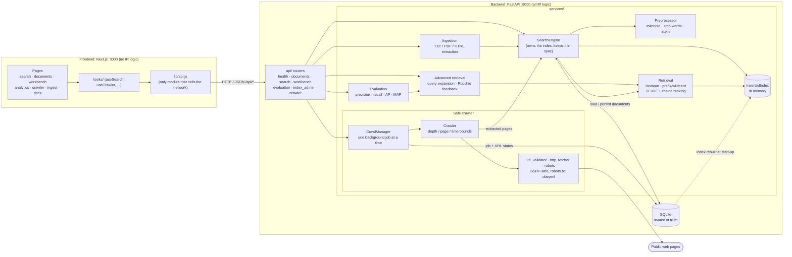

# SearchSphere AI

An interactive **Information Retrieval laboratory**. A FastAPI backend implements the classical IR pipeline from scratch
(preprocessing, inverted index, Boolean / prefix / wildcard / TF-IDF-cosine retrieval, query expansion, Rocchio relevance
feedback, evaluation metrics, TXT/PDF ingestion, a bounded and SSRF-safe web crawler). A Next.js frontend searches the
corpus and **shows the intermediate calculations** behind every score.

No API keys, cloud services, GPUs, Docker or paid dependencies are involved. All data is local (SQLite).

```text
Browser (Next.js, :3000)  ──HTTP/JSON──▶  FastAPI (:8000)  ──▶  SQLite file + in-memory inverted index
   renders results and                      owns ALL IR logic     (SQLite is the source of truth; the
   intermediate calculations                                       index is rebuilt from it at start-up)
```

The frontend contains **no IR logic**: TF-IDF, cosine similarity, Rocchio, query expansion and every evaluation metric are
computed only by the backend; the browser collects input and visualises what the API returns.

## Architecture



A request flows browser → `lib/api.js` → router → service → index/SQLite, and the response (scores plus intermediate
calculations) flows back for the UI to render. Uploaded and crawled documents are written to SQLite first, then added to
the in-memory index.

## Contents

- [Architecture](#architecture) · [Prerequisites](#prerequisites) · [Quick start](#quick-start) · [Configuration](#configuration)
- [Tests](#tests) · [Project structure](#project-structure) · [API map](#api-endpoint-map)
- [How it works](#how-it-works) (search, crawler, workbench, evaluation, analytics)
- [Demo flow](#demo-flow) · [Known limitations](#known-limitations) · [Troubleshooting](#troubleshooting)

## Prerequisites

| Tool | Version | Notes |
|---|---|---|
| Python | 3.10+ (developed and tested on 3.12) | needs `venv` and `pip` |
| Node.js | 22.22.2+ (developed and tested on 26) | `npm` ships with it. The Next.js app itself runs on Node 20.9+; the test tooling (Vitest 5 / jsdom 30) needs the newer versions |
| Internet | once | `pip install`, `npm install` and the one-off NLTK data download. Afterwards everything runs offline, except crawling public web pages. The first `pip install` is large: current PyMuPDF (2.x, used for PDF upload) itself requires `onnxruntime`, `numpy`, `networkx` and others. `requirements.txt` uses minimum versions, so a fresh install picks the newest releases (the suite passed with the versions it resolved on 2026-10-23) |

Commands below are for **Windows PowerShell** (the platform this project was built and tested on). On macOS/Linux use
`source .venv/bin/activate` and plain `python` in place of `.\.venv\Scripts\python`.

## Quick start

Open two terminals from the repository root.

**1. Backend** (http://localhost:8000, interactive API docs at http://localhost:8000/docs)

```powershell
cd backend
python -m venv .venv
.\.venv\Scripts\python -m pip install -r requirements.txt
.\.venv\Scripts\python scripts\setup_nltk.py        # one-time NLTK data download into backend/data/nltk_data
.\.venv\Scripts\python -m app.cli seed              # create the SQLite DB, load 114 demo documents + 10 judged queries, build the index
.\.venv\Scripts\python -m uvicorn app.main:app --reload
```

**2. Frontend** (http://localhost:3000)

```powershell
cd frontend
npm install                  # or `npm ci` to install exactly what package-lock.json pins
npm run dev                  # development server
```

Open <http://localhost:3000>. The header shows **API online · 114 docs indexed** when the frontend can reach the backend.

For a production-style run use `npm run build` then `npm run start` (still port 3000).

> Open the app at **`http://localhost:3000`**, not `http://127.0.0.1:3000`: the backend's default CORS allow-list contains
> `localhost:3000` only (see [Configuration](#configuration) to add other origins).

**Resetting to the pristine demo state.** Uploaded documents and crawl history live in `backend/data/searchsphere.db`
(git-ignored). Stop the backend, delete that file, and run `python -m app.cli seed` again to get exactly the 114 seed
documents, 10 evaluation queries and no crawl jobs.

## Configuration

### Backend

The backend reads **real environment variables** (there is no `.env` loader). Defaults need no configuration. To override one in
PowerShell: `$env:SEARCHSPHERE_CORS_ORIGINS = "http://localhost:3000,http://127.0.0.1:3000"` before starting `uvicorn`.
All variables are optional and listed in [`backend/.env.example`](backend/.env.example):

| Variable | Default | Purpose |
|---|---|---|
| `SEARCHSPHERE_DB_PATH` | `backend/data/searchsphere.db` | SQLite file |
| `SEARCHSPHERE_NLTK_DIR` | `backend/data/nltk_data` | NLTK data directory |
| `SEARCHSPHERE_CORS_ORIGINS` | `http://localhost:5173,http://127.0.0.1:5173,http://localhost:3000` | comma-separated browser origins allowed to call the API |
| `SEARCHSPHERE_WILDCARD_LIMIT` | `50` | max dictionary terms a wildcard may expand to |
| `SEARCHSPHERE_MAX_UPLOAD_BYTES` | `5242880` | upload size limit (5 MB) |
| `SEARCHSPHERE_MAX_DOCUMENT_CHARS` | `200000` | max extracted text per document |
| `SEARCHSPHERE_CRAWLER_*` | see `.env.example` | user agent, delay, response size, redirects, duration, queue size |

### Frontend

| Variable | Default | Purpose |
|---|---|---|
| `NEXT_PUBLIC_API_URL` | `http://localhost:8000` | base URL of the backend (no trailing slash, no secrets) |

Copy `frontend/.env.example` to `frontend/.env.local` to change it. `NEXT_PUBLIC_*` values are inlined at **build time**: set
it before `npm run build` (a running `npm run start` does not pick up later changes). No secrets exist anywhere in the project.

## Tests

| Suite | Command (from the folder) | Covers |
|---|---|---|
| Backend | `.\.venv\Scripts\python -m pytest` (in `backend/`) | 620 tests: preprocessing, index, retrieval, metrics, ingestion, crawler security (fake network + DNS), HTTP API |
| Frontend unit/component | `npm test` (in `frontend/`) | API client, error handling, formatters, search model, hooks (stale-response ordering, crawler polling and cleanup), search/documents/ingest states, workbench state |
| Frontend lint | `npm run lint` | ESLint with the Next.js core-web-vitals rules |
| Frontend build | `npm run build` | production build of all routes |

There is no backend linter or build step configured. The end-to-end browser checks used for acceptance were driven with
`playwright-core` and system Edge from a scratch directory and are **not** part of the repository.

## Project structure

```text
backend/
  app/api/        FastAPI routers: health, documents, search, workbench, evaluation, index_admin, crawler
  app/services/   IR logic: preprocessing, inverted_index, boolean_retrieval, tolerant_retrieval, ranking (TF-IDF/cosine),
                  query_expansion, rocchio, metrics, evaluation, ingestion, crawler + url_validator/http_fetcher/robots (SSRF safety)
  app/database/   SQLite schema, repositories, seed + evaluation loaders, crawl tables
  app/tests/      pytest suite      data/  seed_documents.json, evaluation_queries.json (+ generated SQLite file, NLTK data)
  PHASE2.md, PHASE3.md   algorithm and crawler design notes
frontend/
  app/            routes (/, /search, /documents, /workbench, /analytics, /crawler, /ingest, /docs)
  components/     ui/ (shared kit) layout/ search/ documents/ workbench/ crawler/ analytics/ docs/
  hooks/          useAsync (abort-safe), useSearch, useCrawler (polling), useDebounce, useDocumentsCategories
  lib/            api.js (the only module that calls fetch/XMLHttpRequest), searchModel, formatters, analytics, constants, docsContent
  tests/          Vitest tests
```

## API endpoint map

All routes are under `/api`. Errors share one envelope: `{ "error": { "code", "message", "details" } }`.

| Area | Endpoints | Used by the frontend |
|---|---|---|
| Health | `GET /health` | header status, analytics |
| Search | `POST /search`, `/search/expanded`, `/search/rocchio`, `/search/boolean`, `/search/tolerant`; `GET /search/suggestions` | all but suggestions (client function only) |
| Documents | `GET /documents` (filters: `category`, `source_type`), `GET /documents/{id}`, `POST /documents` (JSON), `POST /documents/upload` (multipart), `DELETE /documents/{id}` | list, detail, upload |
| Workbench | `POST /workbench/preprocess`, `/incidence-matrix`, `/tfidf`, `/cosine`, `/query-expansion`, `/rocchio`, `/relevance-feedback`, `/evaluation`; `GET /workbench/inverted-index` | all but `/relevance-feedback` |
| Evaluation | `POST /evaluation/run`, `/evaluation/map`; `GET /evaluation/dataset` | `map`, `dataset` (single-query uses `/workbench/evaluation`) |
| Crawler | `POST /crawler/validate-url`, `/crawler/start`, `/crawler/{id}/cancel`; `GET /crawler/{id}`, `/crawler/{id}/results`, `/crawler/history` | all |
| Index admin | `POST /index/rebuild`, `GET /index/check` | not used |

## How it works

### Search flow

The URL is the source of truth: `/search?q=machine+learning&mode=ranked&page=2`. `SearchBox` only navigates; `useSearch` runs
the request for the current `(q, mode, page)` and aborts any earlier request, so an older response can never replace a newer one.
Modes map to endpoints: ranked → `/search`, ranked + expansion → `/search/expanded`, pseudo-feedback → `/search/rocchio`
(top 3 assumed relevant), Boolean → `/search/boolean`, prefix/wildcard → `/search/tolerant`. Ranked results carry an
`explanation` (per-term TF, DF, IDF, TF-IDF and the cosine arithmetic) that powers **Why this result?**.

### Crawler flow

`POST /crawler/validate-url` (optional) → `POST /crawler/start` returns a queued job (HTTP 202) → the backend crawls in a background task →
the page polls `GET /crawler/{id}` every 1.5 s until the job is `completed`, `failed` or `cancelled` → `GET /crawler/{id}/results`
lists every URL with its status → `GET /crawler/history` lists all jobs. Reloading the page re-attaches to a queued/running job
found in the history. Only one crawl may be active at a time (a second start gets HTTP 409). Safety rules are enforced by the
backend and cannot be disabled by the UI: http/https only on ports 80/443/8080/8443, every resolved address must be public (SSRF
protection, connection pinned to the validated IP), redirects are re-validated hop by hop, robots.txt is obeyed, and each job is bounded
(at most 100 pages, depth 5, 2 MB per response, 5 redirects, 300 s). Details: [`backend/PHASE3.md`](backend/PHASE3.md).

### IR Workbench

Nine sections, all rendering backend responses: preprocessing, Boolean retrieval (parsed expression tree, evaluation steps,
incidence matrix), inverted index (vocabulary and postings), prefix/wildcard, TF-IDF, cosine similarity, query expansion, Rocchio
(vector arithmetic, ranking before/after, search with the modified query) and evaluation. The active section is in the URL
(`/workbench?tab=rocchio`) and each section keeps its inputs and results while you visit another one.

### Evaluation

Judged queries live in `backend/data/evaluation_queries.json` (loaded by `app.cli seed`). *Single query* shows every count and the
average-precision arithmetic; *MAP* runs all judged queries. Modes: TF-IDF, TF-IDF + expansion, Rocchio with **pseudo**-feedback
(no label leakage). Algorithms: [`backend/PHASE2.md`](backend/PHASE2.md).

### Analytics

The backend has no analytics endpoint, so `/analytics` composes `/health`, `/documents` (first 500 documents), `/crawler/history`
and `/evaluation/map`. Each section loads independently; a failing section does not blank the others.

## Demo flow

The same ten-step script, plus 19 viva questions with answers, is on the in-app **Documentation** page (`/docs`):
search "machine learning" and open *Why this result?* → explore a document → preprocess a sentence → look up "learning" in the
inverted index → Boolean `machine AND learning AND NOT vision` and wildcard `comput*r` → TF-IDF and cosine → expansion and Rocchio →
evaluation and analytics → upload a TXT/PDF and search a distinctive word → validate `http://127.0.0.1/` in the crawler and show that it is blocked.

## Known limitations

- **Search endpoints have no source-type filter.** `GET /documents` does (`source_type=seed|user|crawled`) and the Document
  explorer uses it, but the search endpoints accept only an optional category. The result filters on the search page therefore apply to
  the page of results already retrieved, and say so.
- **Search activity is not stored.** The backend keeps no query history, so Analytics shows no query volume or latency trend (live latency is shown with each search).
- **Boolean mode is not in the evaluation comparison.** The stored judged queries are free text, not Boolean expressions, so MAP is compared across TF-IDF, expansion and Rocchio only.
- **The inverted index stores term frequencies only, not token positions**, so there are no phrase or proximity queries.
- English only; no OCR (scanned PDFs without a text layer cannot be indexed); the crawler does not run JavaScript.
- The index is in memory and rebuilt at start-up; crawl jobs do not survive a backend restart (jobs still queued or running are marked failed at the next start-up: “The server stopped before the crawl finished.”).
- The evaluation dataset is small and locally written, so absolute scores are illustrative.
- The Document explorer's category list and the Analytics charts are built from the first 500 documents (the backend has no category/analytics endpoint); Analytics prints a note when the corpus is larger than that.
- The frontend sets basic security headers but no Content-Security-Policy (Next.js inline scripts would need per-request nonces).
- `npm audit` reports advisories only in development tooling (Tailwind 3 / ESLint toolchains); `npm audit --omit=dev` reports none. They were not force-upgraded.
- No authentication or multi-user separation: this is a single-user laboratory application and must not be exposed to an untrusted network as-is.

## Troubleshooting

| Symptom | Cause / fix |
|---|---|
| Header says **API offline**, pages show "Cannot reach the SearchSphere backend" | The backend is not running, or `NEXT_PUBLIC_API_URL` points elsewhere. Start `uvicorn` on port 8000 |
| Same, but the backend is running and you opened `http://127.0.0.1:3000` | CORS: use `http://localhost:3000`, or set `SEARCHSPHERE_CORS_ORIGINS` to include the origin and restart the backend |
| `NLPResourceError: Required NLTK resources are missing` when starting the backend or running `app.cli` | Run `python scripts\setup_nltk.py` once (needs internet) |
| Empty corpus (0 documents) | Run `python -m app.cli seed` |
| Changed `NEXT_PUBLIC_API_URL` has no effect | Restart `npm run dev`, or rebuild (`npm run build`) for a production run |
| `pip install` fails with `No such file or directory: ...\.venv\Lib\site-packages\onnxruntime\...` | Windows' 260-character path limit: clone the project to a short path such as `C:\dev\SearchSphere-AI`, or enable Windows long paths |
| `npm install` prints "install-scripts … unrs-resolver" | A harmless notice from an optional ESLint resolver binary; install, lint, tests and build all work |
| Port already in use | Stop the other process, or run `uvicorn ... --port 8001` and set `NEXT_PUBLIC_API_URL=http://localhost:8001` plus the matching CORS origin |

Further reading: [`backend/README.md`](backend/README.md), [`backend/PHASE2.md`](backend/PHASE2.md), [`backend/PHASE3.md`](backend/PHASE3.md),
[`frontend/README.md`](frontend/README.md).
